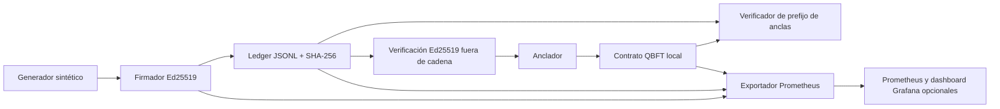

# JaDe Blockchain

JaDe Blockchain es una base de investigación reproducible para inspección de sistemas, integridad de eventos y anclaje en blockchain. Esta primera entrega contiene una demostración local basada en eventos sintéticos, junto con una preparación inicial de infraestructura Proxmox/Ansible. No es una reproducción del laboratorio original ni una certificación forense.

> JaDe Blockchain nace del trabajo de creación e investigación desarrollado por Jacqueline Andrango y Dereck Amacoria. Jacqueline fue parte fundamental de la concepción, creación e investigación del proyecto original. Dereck Amacoria continúa actualmente su desarrollo y mantenimiento, conservando el reconocimiento de las contribuciones originales y dando la bienvenida a colaboradores de la comunidad.

## Estado real

- **Implementado:** CLI Python para generar eventos sintéticos con hash encadenado y firma Ed25519; contador durable e idempotencia por solicitud; verificador estricto; contrato QBFT de un validador; anclador que comprueba las firmas fuera de cadena; métricas Prometheus y dashboard por nodo; módulo inicial Terraform y rol Ansible.
- **Validado localmente:** 22 pruebas Python, prueba/compilación Solidity, auditoría npm sin vulnerabilidades, configuración Compose, reglas Prometheus y dashboard. El recorrido Docker completo verificó un evento firmado y anclado, incluida la repetición idempotente de la solicitud. El workflow CI está definido, pero aún no se ha observado una ejecución completada.
- **Pendiente:** captura real de cambios del anfitrión y eventos Docker, despliegue y restauración en un Proxmox real, varias identidades/nodos de laboratorio, integración de alertas con un canal de notificación y pruebas de operación prolongada.

La demo no inspecciona el anfitrión: solo genera datos sintéticos dentro del contenedor. No se conecta al servidor original, del que no se dispone de código ni acceso. Un firmador Ed25519 software no constituye aislamiento SGX ni atestación remota. Un único validador QBFT tampoco aporta descentralización, independencia administrativa ni alta disponibilidad.

## Inicio rápido: demostración local

Requisitos: Docker Engine con Docker Compose v2 y acceso a imágenes públicas de Besu, Python y Node. La primera compilación descarga dependencias y las imágenes fijadas.

```sh
cp .env.example .env
docker compose --profile synthetic build
docker compose up -d besu contract metrics
docker compose --profile synthetic run --rm demo generate \
  --events /data/events.jsonl \
  --state-dir /data/signer \
  --public-key /data/trusted-public-key.b64 \
  --node demo-node \
  --request-id demo-001
docker compose --profile synthetic run --rm anchor
docker compose --profile synthetic run --rm verifier
```

El verificador Compose consulta el contrato local y muestra JSON con resultados independientes de integridad, autenticidad y cobertura de anclaje. Código de salida: `0` evidencia completa verificada, `1` inválida, `2` incompleta (por ejemplo, anclas ausentes). La CLI Python aislada no consulta la cadena y nunca declara completa la cobertura a partir de un `anchors.json` local sin verificar. Repetir el generador con el mismo `--request-id` devuelve el mismo evento sin incrementar el contador ni duplicarlo.

El RPC de Besu, Prometheus, Grafana y el exportador se publican solo en loopback (`127.0.0.1`). Grafana y Prometheus son opcionales:

```sh
docker compose --profile observability up -d prometheus grafana
```

URLs locales: Grafana `http://127.0.0.1:3000`, Prometheus `http://127.0.0.1:9090`, métricas `http://127.0.0.1:9108/metrics`. Consultar [Operación](docs/OPERATIONS.md) para detener, respaldar y restaurar los servicios. `docker compose down` conserva volúmenes; **no** usar `docker compose down --volumes` como limpieza habitual porque destruye identidad, estado del firmador, cadena local y eventos.

### Ejecutar el núcleo sin Docker

Requiere Python 3.12:

```sh
python3.12 -m venv .venv
. .venv/bin/activate
python -m pip install .
python -m jadeblock.cli generate --events data/events.jsonl \
  --state-dir data/signer --public-key data/trusted-public-key.b64 \
  --request-id demo-001
python -m jadeblock.cli verify --events data/events.jsonl \
  --public-key data/trusted-public-key.b64 --anchors data/anchors.json
```

La clave privada se crea localmente en `data/signer/ed25519.key`; nunca se incluye en la imagen, ejemplos ni fixtures. Protege y respalda conjuntamente la clave, `signer-state.json`, el ledger y los IDs de solicitudes procesadas. Un estado o clave ausente/corrupto detiene el firmador; no restablece silenciosamente el contador. Si el proceso cae tras firmar y antes de registrar el evento, reintenta con el mismo `--request-id`; el CLI bloqueará solicitudes nuevas hasta recuperar ese evento pendiente. No se puede recuperar una firma perdida si no existe un respaldo coherente de ese conjunto.

## Arquitectura



Consulte [Arquitectura](docs/ARCHITECTURE.md), [modelo de amenazas](docs/THREAT_MODEL.md), [operación](docs/OPERATIONS.md), [restauración](docs/RESTORE.md), [decisiones](docs/DECISIONS.md) y [hoja de ruta](docs/ROADMAP.md).

## Réplica de laboratorio

`infrastructure/proxmox` define tres contenedores LXC Debian 12 nuevos a partir de una plantilla, almacenamiento, bridge, IDs, recursos y red recibidos por variables. `ansible/` incluye un inventario de ejemplo y rol inicial para Debian/systemd. Terraform crea infraestructura; Ansible configura el sistema; Docker Compose administra la demo. No hay `terraform apply` automático, provisioners de configuración, importación de recursos, cambios de red del hipervisor ni configuración de OPNsense. Revise cuidadosamente valores e inventario antes de ejecutar en una instalación autorizada.

## Seguridad y limitaciones

- La fuente Solidity autoriza al emisor por nodo y rechaza contadores no crecientes. La firma Ed25519 no se valida dentro de Solidity: el anclador la verifica con la clave pública confiable antes de enviar la transacción.
- Al desplegar, se registra el hash de la fuente y el hash del bytecode runtime compilado. El anclador vuelve a compilar el fuente y comprueba su correspondencia con el bytecode de la dirección desplegada.
- El demo usa QBFT con un único validador local y claves efímeras nuevas por volumen. No contiene dinero ni debe conectarse a una red real.
- Los puertos publicados están ligados a localhost, pero Docker puede interactuar con reglas de firewall de forma distinta a lo esperado. Comprueba las reglas efectivas de Docker, UFW y filtrado IPv6 en el host.
- Terraform `sensitive` oculta valores en la salida de CLI, pero **no cifra** el state. No publiques state, planes, backups, logs ni credenciales.
- El código MIT no cambia la licencia de tesis, imágenes o componentes de terceros que no se incluyen aquí.
- No se prometen invulnerabilidad, certificación forense, garantías judiciales ni seguridad SGX.

La licencia del código es MIT; consulta [LICENSE](LICENSE), [créditos](CREDITS.md), [contribución](CONTRIBUTING.md) y [seguridad](SECURITY.md).
